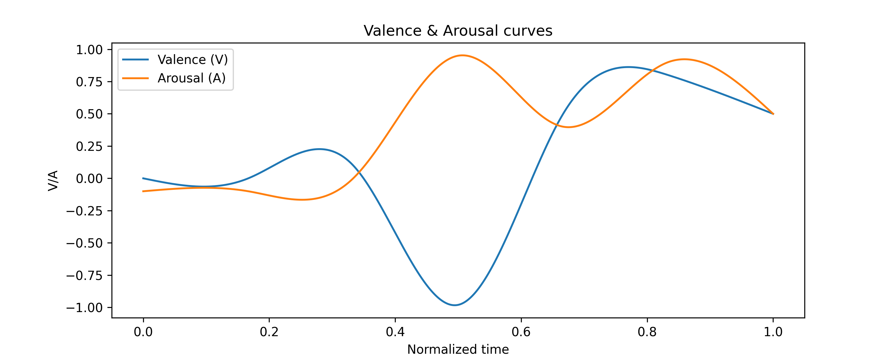
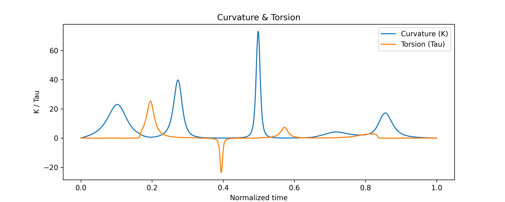

# Story to Music: Differential Geometry for Emotion-Driven Music

Turns a short story into a 30–60 second multi-instrument piece of music.
A transformer classifier reads the story sentence by sentence and detects one of 32 emotions per sentence. Each emotion becomes a point in valence–arousal space. The points are joined into a smooth space curve, and the **differential geometry of that curve** (curvature, torsion, and the Frenet frame) is used to decide the notes, dynamics and instrumentation.

> Course project for *Differential Geometry*, Iran University of Science and Technology (5th semester).
> Developed in December 2025, updated in March 2026, published on GitHub in November 2026.

## Example

Input story ([`examples/sample_run/story.txt`](examples/sample_run/story.txt)):

> Maya climbed the old staircase to her grandmother's attic, smiling at the smell of dust and lavender. She opened a wooden box and found a bundle of letters tied with a faded ribbon. As she read the first page, she missed her grandmother so much that tears filled her eyes. Then she found a letter addressed to her, and her heart pounded with fear of what it might say. The letter said that her grandmother had been proud of her every single day. Maya laughed out loud, overwhelmed with joy and gratitude. She folded the letter carefully, feeling calm and hopeful as the evening sun filled the room.

Output (45 s): [`story_output.mp3`](examples/sample_run/story_output.mp3) and the raw [MIDI file](examples/sample_run/story_output.mid). All plots of this run are in [`examples/sample_run/`](examples/sample_run/).

Valence/arousal curves built from the per-sentence emotions, and the curvature and torsion computed from them:




## How it works

1. **Emotion detection** (`core_emotion.py`): the story is split into sentences. A fine-tuned BERT sequence classifier (`BertForSequenceClassification`, 32 output labels) predicts one of 32 emotions (afraid, angry, annoyed, anticipating, anxious, … trusting) per sentence. A hand-made lookup table maps each emotion to a *(valence, arousal)* pair in [-1, 1]².
2. **Curve construction** (`geometry_engine.py`): the per-sentence valence and arousal values are interpolated with natural cubic splines to get the space curve

   ```
   r(t) = (1, V(t), A(t)),   t in [0, 1]
   ```

3. **Frenet quantities**: from the spline derivatives r', r'', r''' the code computes, at every sample point

   ```
   curvature  kappa = |r' x r''| / |r'|^3
   torsion    tau   = ((r' x r'') . r''') / |r' x r''|^2
   angle      theta = atan2(|r' x r''|, r' . r'')
   ```

   and smooths them with a Gaussian filter.
4. **Instrument roles** (`geometry_engine.py`): six roles (piano, violin, strings, pad, bass, choir) each get their own curve, built as a different weighted mix of V, A, kappa, tau and theta, plus a small sinusoidal and random perturbation so the parts do not move in lockstep.
5. **Notes** (`main.py`): each role curve is normalised and mapped onto a major/minor scale inside the role's pitch range (up to 150 notes per role). Note **velocity comes from the torsion** (48–100, smoothed), and repeated consecutive pitches are merged.
6. **Rendering** (`main.py`): instruments are looked up by name in the available SoundFonts, each role is rendered to WAV with FluidSynth, the parts are mixed with per-instrument gain, and a combined MIDI file is written. A diagnostic plot set is saved with every run (`plot_curves.py`).

### Other modules

`composer.py` and `role_engine.py` contain a more music-theoretic composition layer: key and mode selection from the emotion statistics, chord progressions (I–vi–IV–V and similar, with occasional secondary dominants), a simplified helical "Spiral Array"-style pitch-class distance, quantisation to scale and chord tones, and rhythm templates per emotion family. They are **not part of the pipeline in `main.py`**; an earlier version that used `composer.py` is kept in [`archive/`](archive/) for reference.

## Project layout

```
main.py                PySide6 GUI + full pipeline (entry point)
core_emotion.py        emotion classifier wrapper, emotion -> valence/arousal table
geometry_engine.py     splines, curvature/torsion/theta, role curves, plotting
plot_curves.py         saves the diagnostic plots of a run
composer.py            experimental harmony/key layer (not used by main.py)
role_engine.py         experimental rhythm templates (not used by main.py)
archive/               earlier iterations of the entry point
examples/              sample story with its MIDI/MP3 output and plots
SoundFont/             put .sf2 files here (not included)
Models/goemotions/     put the emotion model here (not included)
```

## Setup

Requires Python 3.10+ and [FluidSynth](https://www.fluidsynth.org/).

```bash
brew install fluidsynth            # macOS (Linux: apt install fluidsynth)
python -m venv .venv && source .venv/bin/activate
pip install -r requirements.txt
```

Two assets are **not included** because of their size:

- **Emotion model**: a fine-tuned BERT sequence-classification model (Hugging Face `transformers` format, 32 labels), placed in `Models/goemotions/` (or set the `STM_MODEL_PATH` environment variable).
- **SoundFonts**: put one or more `.sf2` files in `SoundFont/`. The code prefers `FluidR3_GM.sf2`, `GeneralUser-GS.sf2` and `MORCH.sf2` if present and falls back to any other `.sf2` it finds. Any General MIDI SoundFont works.

## Usage

```bash
python main.py
```

Paste a story, choose a duration (30–60 s) and press **Start**. Each run writes to `runs/run_<timestamp>/`: the per-instrument WAVs, `story_output.wav`, `story_output.mid`, and the plots.

## Known limitations

- Each sentence gets a single emotion label (the arg-max class), so the curve is only as detailed as the sentence count; one-sentence stories give a constant, degenerate curve.
- The major/minor choice in `main.py` is computed on the normalised valence curve, which is always non-negative, so the output is currently always in a major scale. The key-selection logic in `composer.py` (based on the mean valence) is the intended fix.
- The role curves include random noise, so two runs on the same story are not identical.
- The note-level mapping is deliberately simple. The focus of the project is the geometric mapping from emotion curves to musical parameters, not high-quality composition.

## Inspiration

- S. Gul, *Music through Curve Insights*, Mathematics 11(20), 2023 — a differential-geometric view of music as curves in three-dimensional space ([record](https://ideas.repec.org/a/gam/jmathe/v11y2023i20p4398-d1265492.html)).
